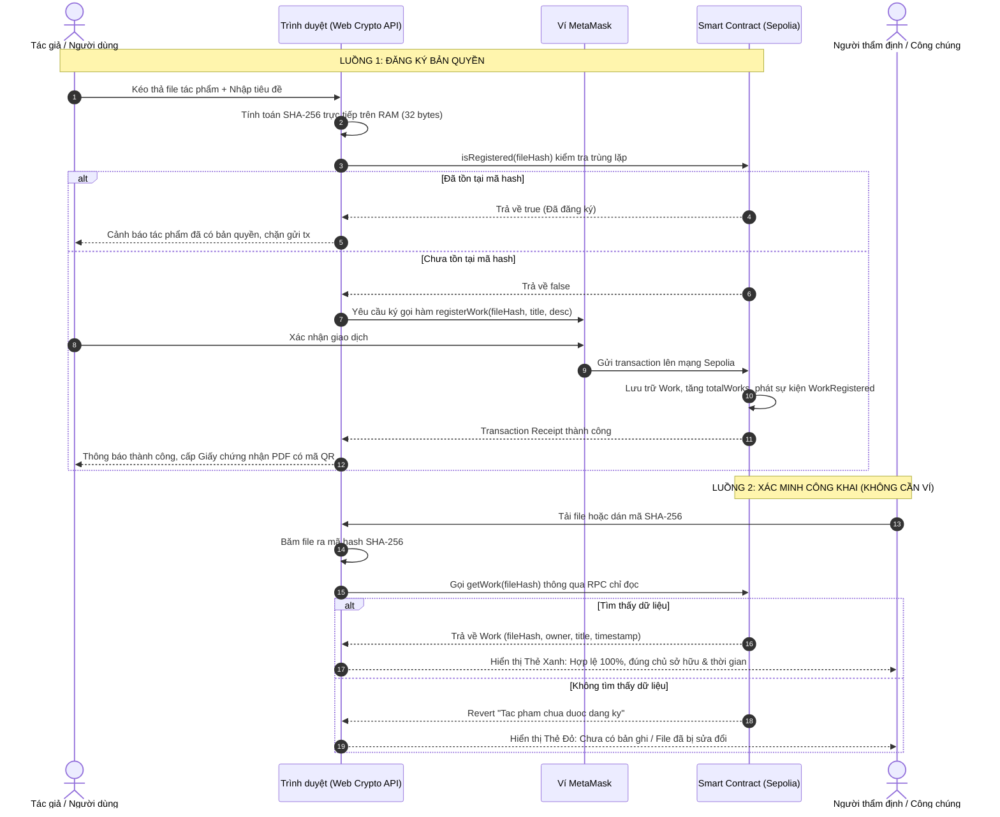

# 🛡️ CopyrightChain - DApp Đăng Ký & Xác Thực Bản Quyền Tác Phẩm Số Trên Blockchain

> **Đồ án sinh viên:** Hệ thống ứng dụng phi tập trung (Decentralized Application - DApp) cho phép đăng ký, quản lý và xác thực bản quyền tác phẩm kỹ thuật số sử dụng công nghệ Blockchain Ethereum Sepolia và chuẩn mã hóa mật mã học SHA-256.

---

## 📑 Mục Lục
1. [Giới thiệu & Ý tưởng hệ thống](#-1-giới-thiệu--ý-tưởng-hệ-thống)
2. [Sơ đồ luồng hoạt động (Workflow Diagram)](#-2-sơ-đồ-luồng-hoạt-động-workflow-diagram)
3. [Công nghệ sử dụng](#-3-công-nghệ-sử-dụng)
4. [Cấu trúc thư mục dự án](#-4-cấu-trúc-thư-mục-dự-án)
5. [Chuẩn bị tài nguyên Testnet](#-5-chuẩn-bị-tài-nguyên-testnet)
6. [Hướng dẫn cài đặt & Cấu hình .env](#-6-hướng-dẫn-cài-đặt--cấu-hình-env)
7. [Chạy kiểm thử & Triển khai Smart Contract](#-7-chạy-kiểm-thử--triển-khai-smart-contract)
8. [Khởi chạy Giao diện Frontend](#-8-khởi-chạy-giao-diện-frontend)
---

## 💡 1. Giới thiệu & Ý tưởng hệ thống

Trong kỷ nguyên số, việc sao chép trái phép các tác phẩm (tranh ảnh, âm nhạc, video, tài liệu, mã nguồn) diễn ra rất phổ biến và khó kiểm soát. Các giải pháp đăng ký bản quyền truyền thống thường tốn nhiều thời gian, chi phí và phụ thuộc vào các tổ chức trung gian tập trung.

**CopyrightChain** giải quyết bài toán này dựa trên các nguyên lý cốt lõi:
- **Bảo mật tuyệt đối file gốc (Client-side Hashing):** Người dùng chọn file trên giao diện, trình duyệt sử dụng `Web Crypto API` để tính toán mã băm mật mã học **SHA-256 (32 bytes)** ngay trên RAM của máy khách. **File gốc KHÔNG BAO GIỜ bị gửi lên máy chủ hay đưa lên blockchain**.
- **Bằng chứng thời gian & Sở hữu bất biến:** Mã băm SHA-256, tiêu đề tác phẩm, địa chỉ ví của tác giả và dấu mốc thời gian block (block timestamp) được lưu trữ vĩnh viễn trên Smart Contract của Ethereum. Dữ liệu này không thể bị sửa đổi, xóa bỏ hay làm giả.
- **Xác thực công khai không cần ví:** Bất kỳ ai có file tác phẩm đều có thể kiểm chứng xem file đã được đăng ký bản quyền chưa, thuộc về ai và vào thời điểm nào mà không cần cài MetaMask hay có ví điện tử.
- **Không backend, không cơ sở dữ liệu tập trung:** Hệ thống vận hành hoàn toàn phi tập trung (Serverless/DApp), Frontend giao tiếp trực tiếp với các RPC node của Ethereum.

---

## 🔄 2. Sơ đồ luồng hoạt động (Workflow Diagram)



---

## 🛠️ 3. Công nghệ sử dụng

| Phân hệ | Công nghệ | Mục đích |
| :--- | :--- | :--- |
| **Smart Contract** | Solidity `^0.8.20` | Viết hợp đồng thông minh lưu trữ và chuyển nhượng bản quyền |
| **Môi trường Web3** | Hardhat, Hardhat Toolbox | Biên dịch, chạy unit test tự động và triển khai contract |
| **Mạng Blockchain** | Ethereum Sepolia PoS Testnet | Mạng thử nghiệm chính thức của Ethereum |
| **Thư viện Web3** | Ethers.js v6 | Tương tác với node RPC và ký giao dịch qua MetaMask |
| **Mật mã học** | Web Crypto API (`SHA-256`) | Tính toán mã băm client-side nhanh và chuẩn xác |
| **Frontend UI** | React 18, Vite | Nền tảng xây dựng Single Page Application hiện đại |
| **Giao diện & CSS** | Tailwind CSS (Dark Mode Fintech) | Thiết kế Glassmorphism, hiệu ứng quầng sáng và lưới vi mô |
| **Chuyển động** | Framer Motion | Hiệu ứng chuyển cảnh mượt mà, counter số tăng dần |
| **Biểu tượng & Toast** | Lucide React, React Hot Toast | Icon giao diện hiện đại và thông báo trạng thái trực quan |
| **Xuất chứng chỉ** | jsPDF + QRCode + Canvas 300DPI | Xuất Giấy chứng nhận bản quyền A4 ngang, hỗ trợ tiếng Việt có dấu chuẩn |

---

## 📂 4. Cấu trúc thư mục dự án

```text
CopyrightChain/
├── contracts/
│   └── CopyrightRegistry.sol           # Smart Contract lưu trữ thông tin bản quyền
├── test/
│   └── CopyrightRegistry.test.js       # 19 ca kiểm thử Unit test (Chai + Ethers v6)
├── scripts/
│   └── deploy.js                       # Script deploy mạng Sepolia & xuất file cho Frontend
├── hardhat.config.js                   # Cấu hình Hardhat, mạng Sepolia & Etherscan
├── package.json                        # Cấu hình dự án Hardhat
├── .env.example                        # Mẫu biến môi trường cho Hardhat
├── .gitignore                          # Cấu hình bỏ qua file nhạy cảm và build artifacts
├── frontend/                           # GIAO DIỆN NGƯỜI DÙNG (REACT + VITE)
│   ├── src/
│   │   ├── contract/
│   │   │   └── CopyrightRegistry.json  # Cấu hình contract { address, abi, chainId }
│   │   ├── context/
│   │   │   └── WalletContext.jsx       # Quản lý kết nối MetaMask & đổi mạng Sepolia
│   │   ├── utils/
│   │   │   ├── hash.js                 # Tính SHA-256 từ file bằng Web Crypto API
│   │   │   ├── contract.js             # Hàm gọi contract (RPC chỉ đọc & Signer)
│   │   │   ├── format.js               # Định dạng địa chỉ ví, ngày giờ VN, dung lượng
│   │   │   └── pdf.js                  # Xuất Giấy chứng nhận PDF A4 ngang có mã QR
│   │   ├── components/
│   │   │   ├── Navbar.jsx              # Thanh điều hướng trên cùng, menu ví
│   │   │   ├── Footer.jsx              # Chân trang thông tin đồ án
│   │   │   ├── BackgroundGlow.jsx      # Quầng sáng gradient và nền lưới chấm
│   │   │   ├── StatCounter.jsx         # Hiệu ứng đếm số tăng dần
│   │   │   ├── LoadingSkeleton.jsx     # Hiệu ứng khung chờ tải dữ liệu
│   │   │   └── TransferModal.jsx       # Hộp thoại xác nhận chuyển quyền sở hữu
│   │   ├── pages/
│   │   │   ├── Home.jsx                # Trang chủ (Hero, Thống kê, Quy trình, Lợi ích)
│   │   │   ├── Register.jsx            # Trang đăng ký bản quyền (Kéo thả, Stepper)
│   │   │   ├── Verify.jsx              # Trang xác minh công khai (/verify & /verify/:hash)
│   │   │   ├── MyWorks.jsx             # Trang quản lý tác phẩm của ví cá nhân
│   │   │   └── NotFound.jsx            # Trang báo lỗi 404
│   │   ├── App.jsx                     # Cấu hình Routes và Toaster
│   │   ├── main.jsx                    # Điểm khởi động ứng dụng React
│   │   └── index.css                   # Tailwind CSS và phong cách Glassmorphism
│   ├── index.html                      # HTML root nhúng Google Fonts tiếng Việt
│   ├── tailwind.config.js              # Cấu hình màu sắc Fintech Web3
│   ├── vite.config.js                  # Cấu hình Vite build
│   ├── .env.example                    # Mẫu cấu hình RPC chỉ đọc cho Frontend
│   └── package.json                    # Dependencies của Frontend
└── README.md                           # Tài liệu hướng dẫn đồ án
```

---

## 🔑 5. Chuẩn bị tài nguyên Testnet

> [!CAUTION]
> **CẢNH BÁO QUAN TRỌNG:**
> **TUYỆT ĐỐI KHÔNG SỬ DỤNG VÍ METAMASK CHỨA TIỀN THẬT (MAINNET)!**
> Luôn tạo một tài khoản ví phụ mới trên MetaMask dành riêng cho việc học tập và nghiên cứu Testnet.

1. **Lấy RPC URL Sepolia:**
   - Đăng ký tài khoản miễn phí tại [Alchemy](https://www.alchemy.com/) hoặc [Infura](https://www.infura.io/).
   - Tạo App chọn chain **Ethereum**, network **Sepolia**, sau đó copy URL RPC dạng HTTPS (Ví dụ: `https://eth-sepolia.g.alchemy.com/v2/YOUR_API_KEY`).
2. **Lấy Private Key của ví phụ:**
   - Mở MetaMask $\rightarrow$ Bấm dấu 3 chấm góc trên bên phải $\rightarrow$ **Chi tiết tài khoản (Account Details)** $\rightarrow$ **Hiển thị khóa riêng tư (Show Private Key)**.
3. **Nhận Sepolia ETH miễn phí (Faucet):**
   - [Google Cloud Web3 Faucet](https://cloud.google.com/application/web3/faucet/ethereum/sepolia) (Nhận 0.05 ETH/ngày)
   - [Alchemy Sepolia Faucet](https://sepoliafaucet.com) (Nhận 0.5 ETH/ngày)
   - [Chainlink Faucets](https://faucets.chain.link/sepolia)
4. **Etherscan API Key** *(Tùy chọn)*:
   - Đăng ký tài khoản miễn phí tại [Etherscan](https://etherscan.io/myapikey) nếu muốn verify mã nguồn Smart Contract công khai trên Etherscan.

---

## ⚙️ 6. Hướng dẫn cài đặt & Cấu hình .env

### 6.1. Cấu hình Backend (Hardhat)
Tại thư mục gốc dự án `CopyrightChain/`:
```bash
# 1. Cài đặt thư viện Hardhat
npm install

# 2. Tạo file .env từ file mẫu
cp .env.example .env
```
Mở file `.env` và điền thông tin ví test của bạn:
```env
SEPOLIA_RPC_URL=https://eth-sepolia.g.alchemy.com/v2/YOUR_ALCHEMY_KEY
PRIVATE_KEY=your_private_key_without_or_with_0x
ETHERSCAN_API_KEY=your_etherscan_api_key_here
```

### 6.2. Cấu hình Frontend
Tại thư mục `CopyrightChain/frontend/`:
```bash
cd frontend

# 1. Cài đặt thư viện Frontend
npm install

# 2. Tạo file .env từ file mẫu
cp .env.example .env
```
Nội dung file `frontend/.env`:
```env
# URL RPC công khai để đọc dữ liệu khi người dùng chưa cài hoặc chưa kết nối MetaMask
VITE_RPC_URL=https://ethereum-sepolia-rpc.publicnode.com
```

---

## 🧪 7. Chạy kiểm thử & Triển khai Smart Contract

Mở terminal tại thư mục gốc `CopyrightChain/`:

### 7.1. Chạy bộ kiểm thử (Unit Tests)
```bash
npm test
```
*Kết quả: Toàn bộ **19/19 ca kiểm thử** bao gồm kiểm tra trùng lặp hash, xác thực quyền tác giả, giới hạn ký tự và thuật toán swap-and-pop đều đạt 100%.*

### 7.2. Chạy thử nghiệm deploy trên mạng Local
```bash
npm run deploy:local
```

### 7.3. Triển khai chính thức lên mạng Ethereum Sepolia
```bash
npm run deploy:sepolia
```
*Sau khi hoàn tất, terminal sẽ in ra địa chỉ contract, đường link Etherscan Sepolia, đồng thời tự động cập nhật file `frontend/src/contract/CopyrightRegistry.json` để Frontend sử dụng ngay.*

---

## 🚀 8. Khởi chạy Giao diện Frontend

Mở một cửa sổ terminal mới và di chuyển vào thư mục `frontend`:

```bash
cd frontend
npm run dev
```

Trình duyệt sẽ tự động mở giao diện tại: **`http://localhost:3000`**

Nếu muốn kiểm tra bản build đóng gói sản phẩm:
```bash
npm run build
npm run preview
```
